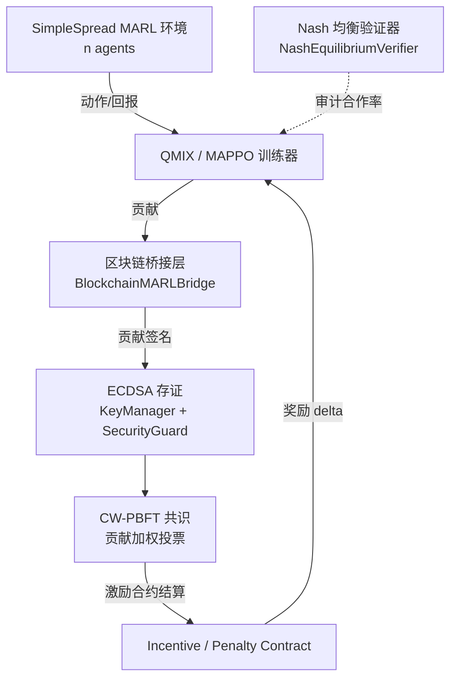
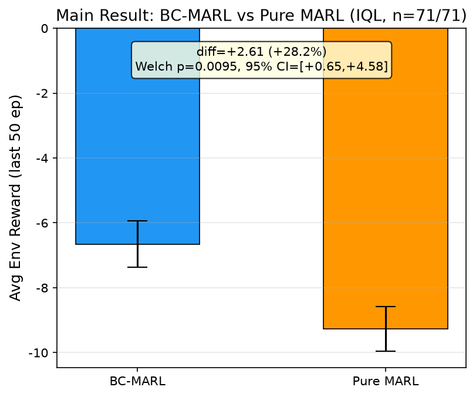

# MARL-ECDSA 共识链

**多智能体强化学习与区块链共识如何互相塑形奖励 —— 一个可复现的实现**

面向协作多智能体的可信共识与激励机制 · ECDSA 签名存证 / CW-PBFT 贡献加权共识 / 链上激励融合 MARL 奖励

- 🌐 项目主页：https://truefurina.github.io/marl-ecdsa/
- ⬇ 下载 Dashboard：见 Releases
- 📊 全部对外数字登记于 [`number_registry.json`](marl-ecdsa-consensus-chain/number_registry.json)（含数据源与复算口径；条数以文件为准），原始运行数据 142 次随包发布
- 📐 本页展示的是 **n=71 基线口径**（NR-1 / NR-2）；后续扩种口径以登记簿为准

## 这个交叉点是什么

大多数「区块链 + MARL」只是把链当日志。这里让两者**双向塑形**：

- **链 → 智能体**：链上激励合约把每个智能体的贡献，按 CW-PBFT 权重折算成奖励 delta，注入 MARL 的回报；
- **智能体 → 链**：协作行为质量反过来决定自己在下一轮共识里的投票权重——自私节点被降权，共识因此偏向合作者。

结果：自私策略在链上激励下被持续抑制，合作率收敛并可用纳什验证器审计（见下图）。

## 仓库结构 / Where to look

| 路径 | 内容 |
|---|---|
| [`marl-ecdsa-consensus-chain/`](marl-ecdsa-consensus-chain/README.md) | **主要实现与文档**：`train.py`/`main.py`、实验与复现脚本、架构、威胁模型、Quick Start。中文版见 [`README.zh.md`](marl-ecdsa-consensus-chain/README.zh.md)（25 节） |
| [`marl-ecdsa-consensus-chain/train.py`](marl-ecdsa-consensus-chain/train.py) | 端到端训练入口：QMIX / MAPPO + 区块链激励双向协同 |
| [`marl-ecdsa-consensus-chain/number_registry.json`](marl-ecdsa-consensus-chain/number_registry.json) | 全部对外数字的登记簿（数据源 + 复算口径），约 480 KB |
| [`marl-ecdsa-consensus-chain/figures/`](marl-ecdsa-consensus-chain/figures/) | 主结果 / 跨算法 / 消融 / 环境多样性 / 自私对比（中英文各一套） |
| [`index.html`](index.html) | 项目主页（GitHub Pages） |
| `demo/`、`assets/` | 演示素材与图标 |

> 只想跑实验：直接进 [`marl-ecdsa-consensus-chain/README.md` 的 Quick Start](marl-ecdsa-consensus-chain/README.md#quick-start)。

---

仅用于科研与教学演示。
